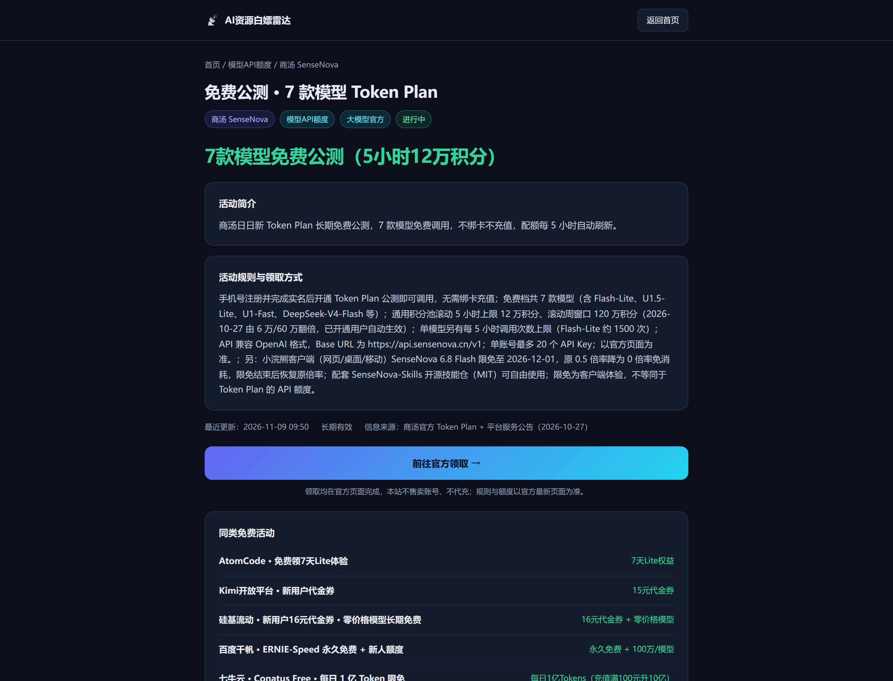
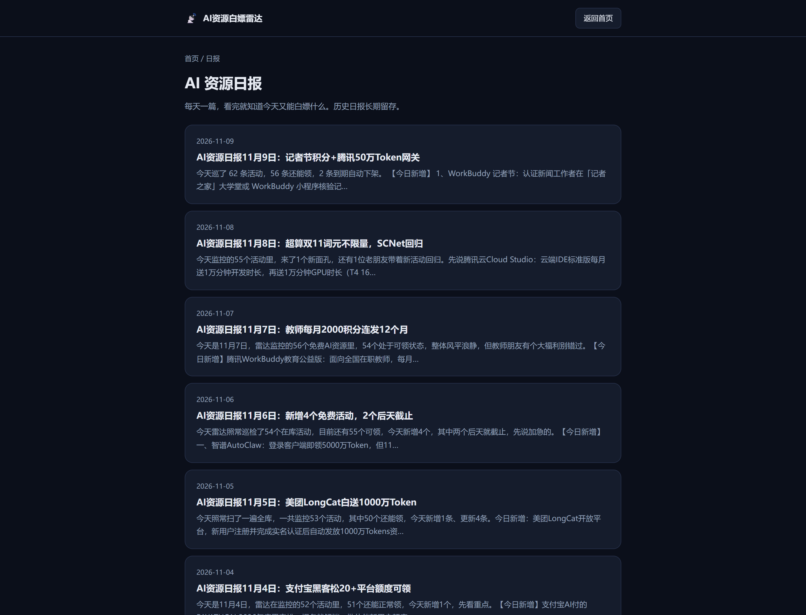
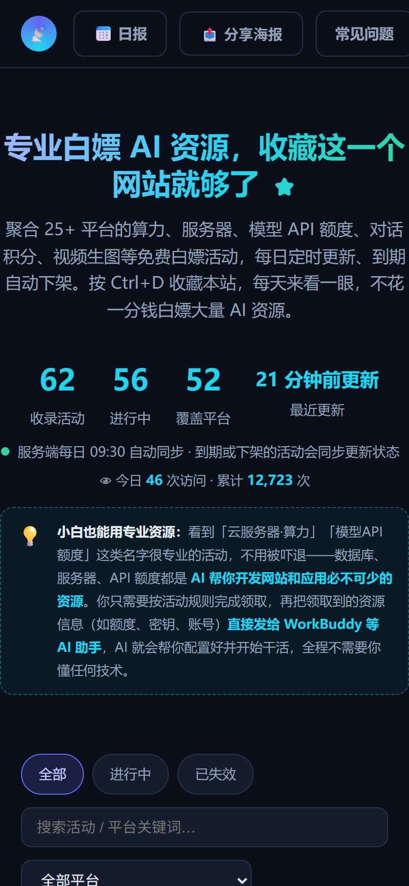
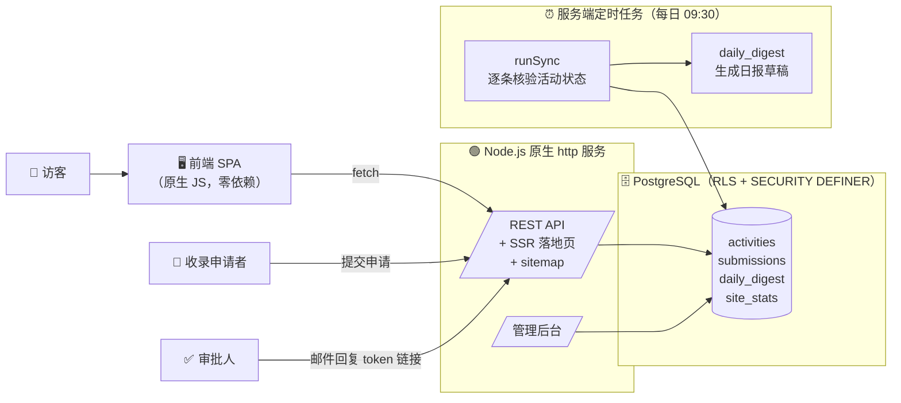

<div align="center">

# 🎯 AI 资源白嫖雷达

**每天自动核验更新 50+ AI 平台的免费额度，一页看全，到期自动下架。**

[](https://ai-credit-hub-44763.app.workbuddy.host/?sharecode=RIOZLFZCRN)
[](https://nodejs.org/)
[](package.json)
[](LICENSE)

[在线体验](https://ai-credit-hub-44763.app.workbuddy.host/?sharecode=RIOZLFZCRN) · [功能特性](#-功能特性) · [快速开始](#-快速开始) · [部署](#-部署) · [API](#-api-一览) · [FAQ](#-faq)


</div>

---

## 🤔 解决什么问题

各家 AI 平台（大模型、视频生成、云厂商、Agent 平台……）都在用「送额度」拉新：

- 🎬 可灵 / 即梦每天送视频生成灵感值
- 🤖 魔搭送免费 GPU 算力、大模型平台送百万级 Token
- ☁️ 云厂商送服务器、API 网关额度
- 🛠️ 开发者工具送部署资源

但这些信息**分散在 50+ 个平台的官网、公众号和活动页里**，而且经常悄悄过期。用户要么一个个去翻，要么拿到一份「过期名单」。

**AI 资源白嫖雷达把这个过程自动化了**：云端定时任务每天核验收录的活动状态，失效自动下架，进行中的活动一页看全，每条标注额度、有效期、领取方式和最后核验时间。

> 💡 新手也能用：数据库 / 服务器这类资源对小白很陌生，站内对每类资源都写了通俗解释——领到额度后直接发给 AI 助手，就能帮你把网站开发环境跑起来。

## ✨ 功能特性

| 模块 | 说明 |
|---|---|
| 🗂️ **五维筛选** | 状态 / 关键词 / 平台 / 资源类型（算力·API·工具·视频）/ 平台属性 |
| ⏰ **每日自动同步** | 服务端内置定时任务（默认 09:30），逐条核验活动链接与状态，到期自动置为已失效 |
| 📡 **SEO 就绪** | 每个活动独立落地页 `/a/<id>`、日报页 `/daily`、`sitemap.xml`、robots.txt、JSON-LD、OG 卡 |
| 📝 **收录申请审批** | 用户提交收录申请 → 生成带 token 的审批链接 → 点「同意 / 拒绝」直接生效，无需登录后台 |
| 🛡️ **管理后台** | `/admin?key=<secret>`：待审列表、一键同步、统计概览 |
| 🖼️ **分享海报** | 前端 Canvas 实时生成 1080×1440 分享海报（含二维码），`/api/qr` 生成任意二维码 |
| 📅 **AI 资源日报** | 每日同步后自动生成日报草稿（`daily_digest` 表），按日期归档展示 |
| 👁️ **访问量统计** | PV/UV 分账统计（会话去重 + 每日 UV），写入走数据库原子函数，前端不可篡改 |
| 🧱 **零框架** | Node.js 原生 `http` 服务端 + 原生前端，生产依赖仅 2 个，部署即跑 |

## 📸 页面预览

| 活动详情页 | 每日日报 |
|---|---|
|  |  |

| 移动端（响应式） | |
|---|---|
|  | |

## 🏗️ 技术架构



- **数据层**：PostgreSQL，全表开启 RLS；所有写操作通过 `SECURITY DEFINER` 函数完成（带服务端密钥校验），前端无直接写权限
- **服务端**：原生 `http`，无 Express；服务端渲染活动详情页与日报页（对搜索引擎友好）
- **前端**：单文件 SPA，零外部 CDN 依赖，弱网也能加载

## 🚀 快速开始

> 环境要求：Node.js ≥ 18

```bash
# 1. 克隆
git clone https://github.com/<你的用户名>/ai-freebie-radar.git
cd ai-freebie-radar

# 2. 安装依赖（仅 2 个生产依赖）
npm install

# 3. 生成你的配置
cp config.example.json config.json
#    编辑 config.json，填入你的数据库/云服务信息（见下方配置说明）

# 4. 启动
PORT=3000 node server.js
# 打开 http://localhost:3000/?sharecode=<你的shareCode>
```

### 配置说明

所有配置支持两种方式：**config.json**（本地开发）或 **环境变量**（云端部署，优先级更高）。

| 配置项 | 环境变量 | 说明 |
|---|---|---|
| `cloud.endpoint` | `CLOUD_ENDPOINT` | 数据库/云服务接入点 |
| `cloud.oauthRelayBaseUrl` | `CLOUD_OAUTH_RELAY` | OAuth 中转地址 |
| `cloud.publishableKey` | `CLOUD_PUBLISHABLE_KEY` | 可公开的发布密钥（可进前端） |
| `secret` | `SVC_SECRET` | **服务端密钥**：`/api/sync`、`/admin`、`/api/admin/*` 的鉴权凭据，请用随机长字符串 |
| `shareCode` | `SHARE_CODE` | 网关分享码：前端访问链接需携带 `?sharecode=` |
| `sync.hour / sync.minute` | – | 每日定时同步时刻，默认 09:30 |

> ⚠️ `config.json` 含密钥，已被 `.gitignore` 排除，**切勿提交到仓库**。生成随机密钥：`node -e "console.log(require('crypto').randomBytes(24).toString('hex'))"`

## ☁️ 部署

### 方式一：任意 Node 主机（VPS / 云服务器）

```bash
# 使用 PM2 常驻
npm i -g pm2
PORT=3000 SVC_SECRET=<密钥> CLOUD_ENDPOINT=<接入点> ... pm2 start server.js --name freebie-radar
```

国内服务器 + 自有域名 = 搜索引擎可正常抓取（子域网关托管时蜘蛛可能被 403，详见 FAQ）。

### 方式二：Serverless / 容器平台（Railway / Render / Fly.io 等）

配置环境变量（见上表）→ 启动命令 `node server.js` 即可。所有配置均可用环境变量注入，无需提交 config.json。

### 方式三：WorkBuddy 应用

在 WorkBuddy 对话中描述需求即可一键生成并发布同款应用，云数据库、定时任务、托管全部自动配置。

## 🔌 API 一览

| 方法 | 路径 | 说明 |
|---|---|---|
| GET | `/api/activities` | 活动列表（全量 + 统计摘要） |
| POST | `/api/submit` | 提交收录申请 |
| GET | `/api/review?token=xxx&action=approve` | 凭 token 审批收录申请 |
| POST | `/api/visit` | 访问计数（蜘蛛 UA 过滤 + 同 IP 防抖） |
| GET | `/api/stats` | 访问统计（今日 / 累计） |
| GET | `/api/digest` | 日报数据 |
| GET | `/api/qr?text=` | 二维码 SVG |
| GET | `/api/health` `/api/diag` | 健康检查 / 诊断 |
| POST | `/api/sync?key=<secret>` | 手动触发同步 |
| GET | `/admin?key=<secret>` | 管理后台 |
| GET | `/a/<id>` `/daily` `/sitemap.xml` `/robots.txt` | SSR 页面 / SEO |

## 📁 目录结构

```
ai-freebie-radar/
├── server.js            # 服务端：API、SSR、定时同步（核心，约 700 行）
├── pages.js             # 服务端渲染：活动详情页 / 日报页 / head 模板
├── index.html           # 前端 SPA（单文件，零 CDN 依赖）
├── admin-page.js        # 管理后台页面
├── config.example.json  # 配置模板（复制为 config.json 后填写）
├── scripts/             # 辅助脚本（海报生成 / 截图）
└── docs/screenshots/    # README 截图
```

## ❓ FAQ

<details>
<summary><b>数据从哪来？会一直更新吗？</b></summary>

收录各平台官方公开的免费活动，服务端每日定时逐条核验：链接失效或活动到期自动标记「已失效」。收录申请走审批流程，人工确认后上架。
</details>

<details>
<summary><b>为什么前端链接都带 <code>?sharecode=</code>？</b></summary>

托管网关要求所有请求携带分享码，否则返回 403。若你部署在自有服务器（无网关），可把 `shareCode` 留空，`absUrl()` 会自动不再追加。
</details>

<details>
<summary><b>部署到托管域名后，搜索引擎能收录吗？</b></summary>

托管子域网关（如本站的 <code>app.workbuddy.host</code>）会对不带分享码的蜘蛛请求返回 403，且站长平台对共享主域名的子域名有收录配额限制。要做 SEO 请部署到<b>自有域名</b>（国内服务器需备案）。
</details>

<details>
<summary><b>邮件审批是怎么实现的？</b></summary>

收录申请会生成两条带独立 token 的审批链接（同意 / 拒绝）。你可以把链接通过任意通知渠道（邮件 / IM / Webhook）发给审批人，点击即生效。本项目中的「邮件助理」由外部自动化任务驱动，仓库本身不绑定任何邮件服务。
</details>

<details>
<summary><b>页面上的访问量数字是真实的吗？</b></summary>

前端展示值 = 历史基线 + 真实计数。真实 PV/UV 记录在 `site_stats` 表中（会话去重、每日 UV、蜘蛛过滤、防刷），可在后台查看原始数据。
</details>

## 🛣️ Roadmap

- [ ] 活动订阅：邮件 / RSS 推送每日新增
- [ ] 多语言界面
- [ ] 活动卡片社交分享卡优化
- [ ] 更多平台的自动抓取连接器

## ⚠️ 免责声明

本站仅聚合各平台**官方公开**的免费活动信息并注明来源，不代运营任何账号、不收取任何费用。活动额度、规则以各平台官方页面为准，若活动变动请以官方说明为准。

## 📄 License

[MIT](LICENSE) © 2026

---

<div align="center">

**如果这个项目帮到了你，欢迎点个 Star ⭐ 支持一下**

[🚀 在线体验](https://ai-credit-hub-44763.app.workbuddy.host/?sharecode=RIOZLFZCRN)

</div>
